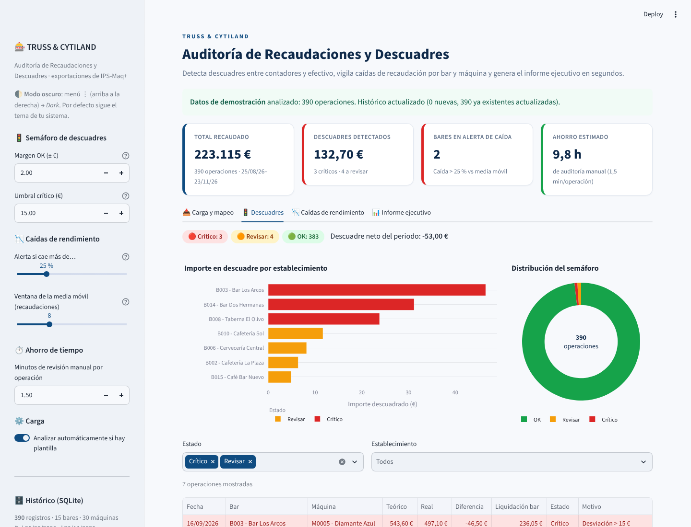
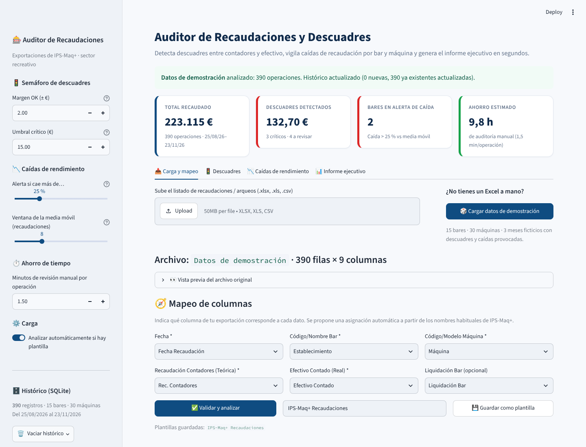
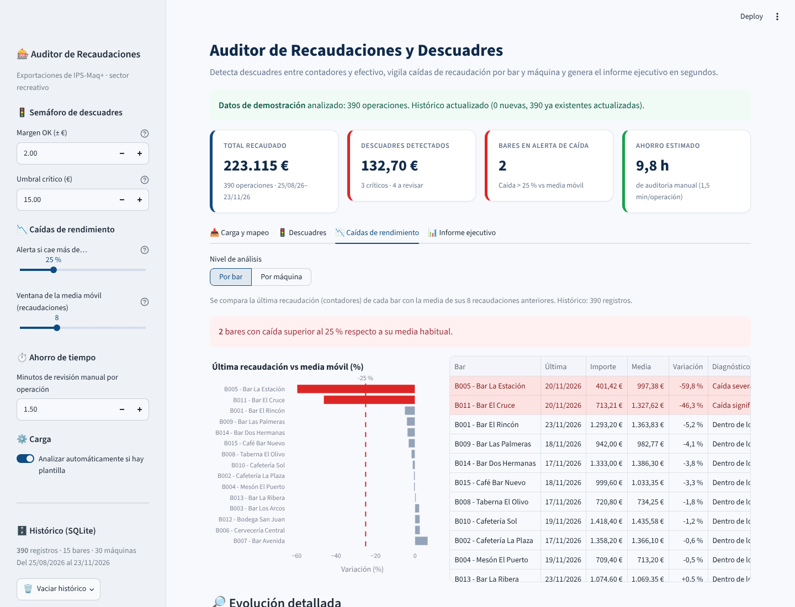
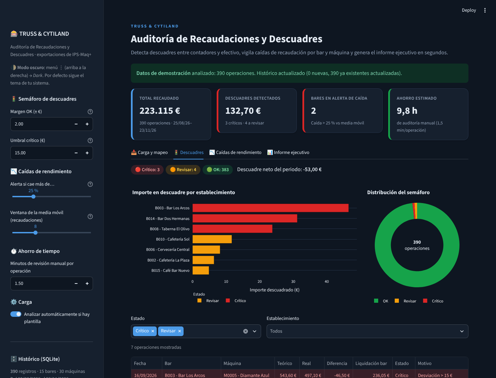

# 🎰 TRUSS & CYTILAND · Auditoría de Recaudaciones y Descuadres

**Auditoría automática de recaudaciones de máquinas recreativas a partir de exportaciones del ERP IPS-Maq+.**
Detecta descuadres entre contadores y efectivo, vigila caídas de recaudación por bar y por máquina y genera un informe ejecutivo en Excel en segundos.


**🔗 Demo en vivo: [auditor-recaudaciones.streamlit.app](https://auditor-recaudaciones.streamlit.app/)** (pulsa *Cargar datos de demostración*)



---

## 💼 El problema de negocio

En una operadora de máquinas recreativas (tipo B) cada semana se recaudan decenas de bares. Por cada visita hay que comparar:

- la **recaudación teórica** que marcan los contadores de la máquina,
- el **efectivo realmente contado** en el arqueo, y
- la **liquidación** que corresponde al establecimiento.

Este cuadre se hace a mano en Excel, fila a fila. Es lento, propenso a errores y, sobre todo, **reactivo**: una máquina averiada, apagada o manipulada puede pasar semanas sin que nadie lo note porque su recaudación "baja un poco".

**El Auditor convierte esa revisión manual en un proceso de 30 segundos**: sube el listado, la herramienta marca qué revisar y genera el informe para gerencia.

## ✨ Funcionalidades clave

| Módulo | Qué hace |
|---|---|
| **Carga inteligente** | Lee `.xlsx`, `.xls` y `.csv` (separador, codificación y formato `1.234,56 €` autodetectados). Asistente visual para mapear las columnas del informe de IPS-Maq+ con **sugerencia automática** y **plantillas reutilizables** (`config_columnas.json`). Botón de **datos de demostración**. |
| **Motor de descuadres** | Calcula `Real − Teórico` por operación y aplica un semáforo configurable: 🟢 OK (±2 €), 🟠 Revisar (2,01–15 €), 🔴 Crítico (>15 € o recaudación 0 €). |
| **Motor de caídas** | Guarda el histórico en SQLite sin duplicados (`Fecha + Bar + Máquina`) y compara la última recaudación de cada bar/máquina con su **media móvil** de recaudaciones previas. Alerta si cae más de un **25 %** (slider). Diagnóstico: posible avería oculta, máquina apagada o cambio de tendencia. |
| **Modo claro y oscuro** | Tema corporativo en ambos modos (sigue al sistema o se elige en el menú ⋮). Tarjetas, tablas y gráficos se adaptan automáticamente. |
| **Dashboard** | Tarjetas KPI (total recaudado, € en descuadres, bares en alerta, horas de auditoría ahorradas), gráficos Plotly interactivos y tablas con colores de alerta. |
| **Informe ejecutivo** | Excel multi-pestaña (`Resumen_Ejecutivo`, `Descuadres_Criticos`, `Bares_En_Riesgo`) con cabeceras corporativas, autoajuste de columnas, formato moneda €, filtros y formato condicional. |

| Carga y mapeo | Caídas de rendimiento |
|---|---|
|  |  |

**Modo oscuro**



## 🏗️ Arquitectura técnica

```
01-auditor-recaudaciones/      # módulo 1 de la suite Automatizaciones TRUSS/CYTILAND
├── app.py                 # Interfaz Streamlit (UI, estado de sesión, gráficos)
├── analyzer.py            # Lógica de negocio pura: lectura, mapeo, descuadres, caídas, KPIs, Excel
├── database.py            # Persistencia SQLite (UPSERT con clave única fecha+bar+máquina)
├── sample_data.py         # Generador de datos ficticios con incidencias provocadas
├── lanzador.py            # Arranque local: puerto libre + apertura del navegador
├── iniciar_auditor.bat    # Doble clic en Windows: venv + dependencias + app
├── requirements.txt
├── .streamlit/config.toml # Tema corporativo claro y oscuro
└── docs/                  # Capturas para este README
```

```
 Excel / CSV IPS-Maq+ ──► Mapeo de columnas ──► Normalización (fechas, importes €)
                                                       │
                       ┌───────────────────────────────┴──────────────────┐
                       ▼                                                  ▼
             Motor de descuadres                               SQLite (auditoria.db)
          (semáforo Real − Teórico)                         histórico sin duplicados
                       │                                                  │
                       │                                   Motor de caídas (media móvil)
                       └──────────────► KPIs + Dashboard ◄────────────────┘
                                              │
                                     Informe Excel ejecutivo
```

Decisiones de diseño:

- **Separación UI / lógica**: `analyzer.py` y `database.py` no dependen de Streamlit, así que se pueden reutilizar en scripts programados o en otra interfaz.
- **Idempotencia**: subir dos veces el mismo listado no duplica datos (`INSERT … ON CONFLICT DO UPDATE`).
- **Media móvil sin fuga de información**: la media de cada punto se calcula solo con las recaudaciones *anteriores*, para que una caída no se "diluya" en su propia media.
- **Privacidad por defecto**: el `.gitignore` bloquea bases de datos, Excel, CSV y `.env`; solo se permite el Excel ficticio generado por código.

## 🚀 Instalación local con un clic (Windows)

1. Instala **Python 3.10 o superior** desde [python.org](https://www.python.org/downloads/) marcando **"Add python.exe to PATH"**.
2. Descarga o clona el repositorio y entra en la carpeta `01-auditor-recaudaciones`.
3. Haz **doble clic en `iniciar_auditor.bat`**.

La primera vez crea el entorno virtual `.venv` e instala las dependencias (1-3 minutos). Las siguientes veces arranca en segundos y abre el navegador automáticamente. Si cambias `requirements.txt`, el lanzador reinstala solo lo necesario.

### macOS / Linux (o manual)

```bash
cd 01-auditor-recaudaciones
python -m venv .venv
source .venv/bin/activate          # Windows: .venv\Scripts\activate
pip install -r requirements.txt
python sample_data.py              # opcional: genera datos_ejemplo_ips.xlsx
streamlit run app.py
```

## 🧭 Guía rápida de uso

1. **Carga** un listado de recaudaciones de IPS-Maq+ o pulsa **🎲 Cargar datos de demostración**.
2. **Revisa el mapeo** de columnas (viene propuesto) y pulsa **Validar y analizar**. Guarda el mapeo como plantilla y las siguientes subidas se analizarán solas.
3. Ajusta en la barra lateral el **margen OK**, el **umbral crítico**, el **% de caída** y la **ventana de la media móvil**.
4. Revisa las pestañas **Descuadres** y **Caídas de rendimiento**.
5. Descarga el **informe Excel** desde *Informe ejecutivo*.

## ☁️ Despliegue gratuito en Streamlit Community Cloud

1. Sube el proyecto a un repositorio **público** de GitHub (comprueba con `git status` que no hay `.db`, `.xlsx` reales ni `.env`).
2. Entra en [share.streamlit.io](https://share.streamlit.io) con tu cuenta de GitHub.
3. **Create app → Deploy a public app from GitHub** y selecciona: repositorio, rama `main` y archivo principal `01-auditor-recaudaciones/app.py`. Streamlit usa el `requirements.txt` de esa misma carpeta.
   - Si el tema corporativo no se aplica en la nube, copia `.streamlit/config.toml` también a la raíz del repositorio.
4. Pulsa **Deploy**. En 2-3 minutos tendrás una URL pública `https://<tu-app>.streamlit.app` para tu portfolio.

> En la nube el sistema de archivos es efímero: el histórico SQLite y las plantillas se reinician cuando la app se reinicia. Para la demo pública es lo deseable; para uso real, ejecútala en local o conecta una base de datos externa.

## 🧪 Datos de demostración

`sample_data.py` genera 15 bares, 30 máquinas y ~3 meses de recaudaciones semanales **ficticias** con:

- 3 descuadres críticos y 4 moderados intencionados,
- 2 bares con una caída brusca de recaudación en su última visita.

Ningún dato real de clientes ni de la empresa forma parte del repositorio.

## 🗺️ Próximos pasos

- ✅ Control de vencimientos de contratos: [02-gestor-contratos](../02-gestor-contratos/).
- ✅ Optimización de rutas de recaudación y averías por modelo: [03-optimizador-rutas](../03-optimizador-rutas/).
- Alertas por correo programadas.

---

Desarrollado con Python, Streamlit, Pandas, Plotly y SQLite.
