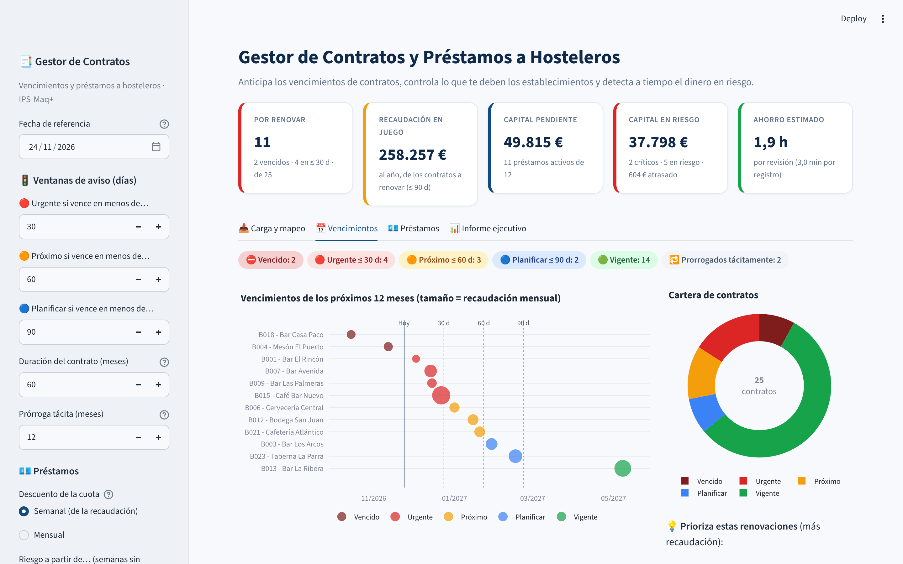
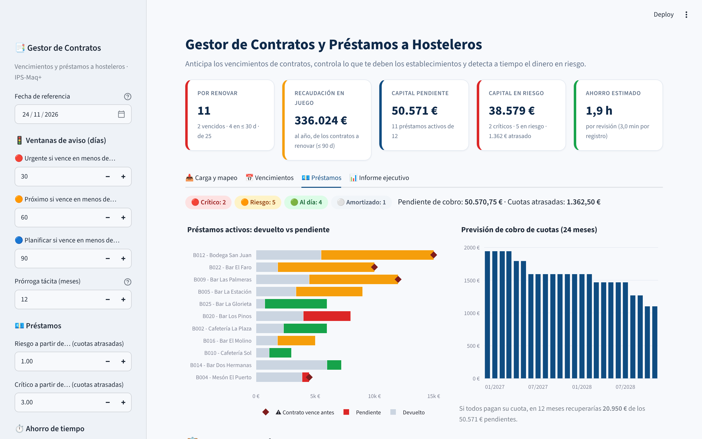
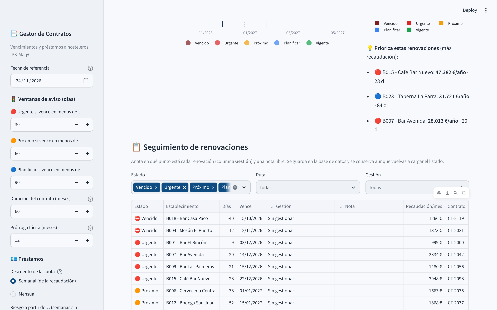

# 📑 Gestor de Contratos y Préstamos a Hosteleros

**Control de vencimientos de contratos y de préstamos a establecimientos para operadoras de máquinas recreativas, a partir de exportaciones del ERP IPS-Maq+.**
Avisa de los contratos que vencen en 30/60/90 días, lleva el seguimiento de cada renovación, controla lo que te deben los hosteleros y detecta el dinero en riesgo antes de que se pierda.


Módulo 2 de la suite [Automatizaciones TRUSS/CYTILAND](../README.md).

**🔗 Demo en vivo: [gestor-contratos.streamlit.app](https://gestor-contratos.streamlit.app/)** (pulsa *Cargar datos de demostración*)



---

## 💼 El problema de negocio

Una operadora tiene firmados decenas de contratos de instalación con bares y cafeterías, y a muchos de ellos les ha adelantado dinero (préstamos o anticipos) que se recupera descontando una cuota de cada recaudación semanal de la máquina.

En el día a día eso se controla con listados sueltos y la memoria del comercial. Las consecuencias son conocidas:

- un contrato **vence sin que nadie lo renegocie** y la competencia se lleva el local (y su recaudación);
- un préstamo **deja de descontarse** unos meses y nadie lo nota hasta que la deuda es grande;
- se presta dinero a un bar cuyo contrato **termina antes de que el préstamo se haya devuelto**.

**El Gestor cruza contratos, préstamos y recaudación en una sola pantalla** y dice cada mañana qué renovar primero y qué dinero está en riesgo.

## ✨ Funcionalidades clave

| Módulo | Qué hace |
|---|---|
| **Carga inteligente** | Tres listados (contratos, préstamos y recaudación opcional) en `.xlsx`, `.xls` o `.csv`, con **selección de hoja**, sugerencia automática de columnas, **plantillas reutilizables** (`config_columnas.json`) y botón de **datos de demostración**. |
| **Semáforo de vencimientos** | ⛔ Vencido · 🔴 Urgente (≤ 30 d) · 🟠 Próximo (≤ 60 d) · 🔵 Planificar (≤ 90 d) · 🟢 Vigente. Ventanas configurables, **prórrogas tácitas** y **fecha límite de preaviso**. |
| **Seguimiento de renovaciones** | Tabla editable para marcar cada contrato como *Contactado, En negociación, Renovado* o *No renueva*, con nota libre. Se guarda en SQLite y se conserva entre cargas. |
| **Control de préstamos** | Cuota **semanal o mensual** (descontada de la recaudación de la máquina), saldo pendiente, **semanas sin descontar** (lo que debería estar devuelto vs. lo devuelto), fecha prevista de fin y **saldo que quedaría al vencer el contrato**. Semáforo: 🔴 Crítico · 🟠 Riesgo · 🟢 Al día · ⚪ Amortizado. |
| **Cruce con recaudación** | Recaudación media mensual por bar para **priorizar renovaciones por dinero en juego** y ver qué parte de la liquidación del bar se va en la cuota. |
| **Dashboard e informe** | KPIs (contratos por renovar, recaudación en juego, capital pendiente y en riesgo, horas ahorradas), gráficos Plotly y Excel multi-pestaña (`Resumen_Ejecutivo`, `Vencimientos`, `Prestamos`, `Calendario_Cobros`). |

| Préstamos | Seguimiento de renovaciones |
|---|---|
|  |  |

## 🏗️ Arquitectura técnica

```
02-gestor-contratos/
├── app.py                        # Interfaz Streamlit (UI, estado de sesión, gráficos, tabla editable)
├── analyzer.py                   # Lógica pura: lectura, mapeo, vencimientos, préstamos, cruce, KPIs, Excel
├── database.py                   # SQLite: cartera de contratos/préstamos, recaudación mensual y seguimiento
├── sample_data.py                # Generador de datos ficticios con escenarios provocados
├── lanzador.py                   # Arranque local: puerto libre + apertura del navegador
├── iniciar_gestor_contratos.bat  # Doble clic en Windows: venv + dependencias + app
├── requirements.txt
├── .streamlit/config.toml        # Tema corporativo claro (igual que el Auditor)
└── docs/                         # Capturas para este README
```

```
 Contratos IPS-Maq+ ──► Mapeo ──► Semáforo de vencimientos ──┐
                                   (prórroga tácita, preaviso) │
 Préstamos IPS-Maq+ ──► Mapeo ──► Cuotas, retraso, fin previsto┼──► Cruce por establecimiento ──► KPIs + Dashboard
                                                               │        (riesgo de contrato)          │
 Recaudación (opc.) ──► Mapeo ──► Media mensual por bar ───────┘                               Informe Excel
                                         │
                               SQLite (gestor_contratos.db): cartera + histórico + seguimiento
```

Decisiones de diseño:

- **La cartera es una foto**: cada exportación de contratos o préstamos sustituye a la anterior (es el listado completo), mientras que la recaudación se acumula por mes sin duplicados y el **seguimiento** se conserva siempre.
- **Cálculo a fecha de referencia**: por defecto hoy; se puede mover para ver cómo estará la cartera en otra fecha.
- **Cruce tolerante entre listados**: `B001 - Bar El Rincón` y `BAR EL RINCON` se reconocen como el mismo establecimiento.
- **Separación UI / lógica** y **privacidad por defecto**, igual que en el Auditor.

### Supuestos del cálculo

- Los préstamos se devuelven en **cuotas iguales descontadas de la recaudación semanal de la máquina** (periodicidad configurable: semanal o mensual), con la primera cuota un periodo después de la concesión. Si falta la cuota se deduce del nº de cuotas; si faltan ambos se asumen 36 meses.
- Los contratos de instalación son de **5 años** (configurable). Si el listado no trae fecha de vencimiento, se calcula como fecha de alta + duración.
- **Retraso** = importe que debería estar devuelto hoy − importe realmente amortizado (o importe − saldo pendiente).
- **Crítico**: ≥ 6 semanas sin descontar o contrato vencido con saldo. **Riesgo**: ≥ 2 semanas sin descontar, contrato que termina antes de amortizar o préstamo sin contrato localizado. Umbrales configurables.
- Un contrato con **prórroga automática** cuya fecha ya pasó se considera prorrogado por periodos de 12 meses (configurable) y no genera riesgo de préstamo.

> ⚖️ **Normativa**: en España la instalación de máquinas tipo B en hostelería la regula el reglamento de máquinas recreativas y de azar de cada comunidad autónoma (autorización de instalación o emplazamiento, su vigencia, renovación y preaviso). Duraciones, prórrogas y preavisos son parámetros de la barra lateral para adaptarlos a vuestra comunidad y a vuestros contratos tipo; la herramienta no sustituye el asesoramiento jurídico.

## 🚀 Instalación local con un clic (Windows)

1. Instala **Python 3.10 o superior** desde [python.org](https://www.python.org/downloads/) marcando **"Add python.exe to PATH"**.
2. Descarga o clona el repositorio y entra en la carpeta `02-gestor-contratos`.
3. Haz **doble clic en `iniciar_gestor_contratos.bat`**.

La primera vez crea el entorno virtual e instala dependencias (1-3 minutos); después arranca en segundos. Puede funcionar a la vez que el Auditor: el lanzador busca un puerto libre.

### macOS / Linux (o manual)

```bash
cd 02-gestor-contratos
python -m venv .venv
source .venv/bin/activate          # Windows: .venv\Scripts\activate
pip install -r requirements.txt
python sample_data.py              # opcional: genera datos_ejemplo_contratos.xlsx
streamlit run app.py
```

## 🧭 Guía rápida de uso

1. En **Carga y mapeo**, sube el listado de contratos de IPS-Maq+ (y, si quieres, el de préstamos y la recaudación) o pulsa **🎲 Cargar datos de demostración**.
2. Revisa el mapeo propuesto, pulsa **Validar y guardar** y guárdalo como plantilla para que la próxima vez se cargue solo.
3. En **Vencimientos**, empieza por los contratos de más recaudación y anota la gestión de cada uno; pulsa **Guardar seguimiento**.
4. En **Préstamos**, revisa los críticos y los que vencen antes de amortizarse.
5. Descarga el **informe Excel** para gerencia desde *Informe ejecutivo*.

## ☁️ Despliegue gratuito en Streamlit Community Cloud

1. En [share.streamlit.io](https://share.streamlit.io): **Create app → Deploy a public app from GitHub**.
2. Repositorio de la suite, rama `main` y archivo principal `02-gestor-contratos/app.py` (usa el `requirements.txt` de esa carpeta).
3. Pulsa **Deploy** y añade la URL a la tabla del README principal.

> En la nube el sistema de archivos es efímero y compartido por los visitantes: la base de datos y las notas de seguimiento se reinician al reiniciarse la app. Para uso real, ejecútala en local.

## 🧪 Datos de demostración

`sample_data.py` genera, siempre respecto a la fecha de hoy, 25 contratos, 12 préstamos y 12 meses de recaudación **ficticios** con:

- 2 contratos vencidos, 2 prorrogados tácitamente, 4 urgentes, 3 próximos y 2 a planificar;
- 3 préstamos con cuotas atrasadas (1 crítico), 3 cuyo contrato vence antes de amortizarse, 1 con contrato ya vencido y 1 ya devuelto.

Ningún dato real de clientes ni de la empresa forma parte del repositorio.

---

Desarrollado con Python, Streamlit, Pandas, Plotly y SQLite.
