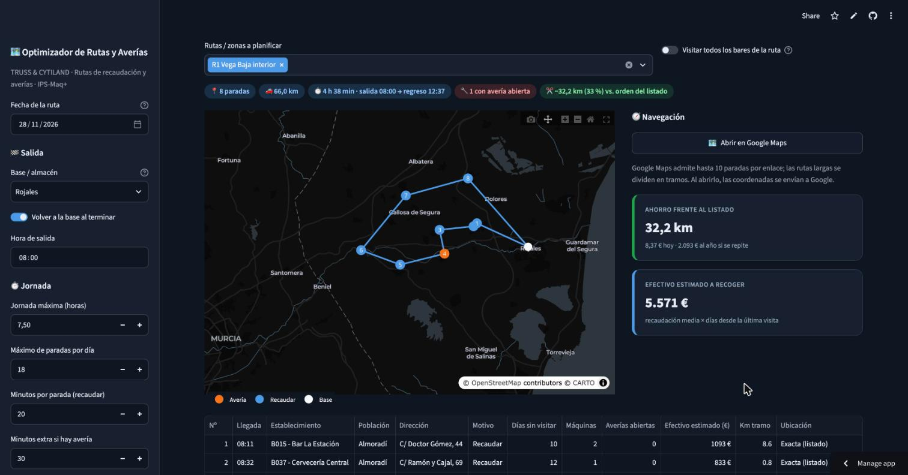
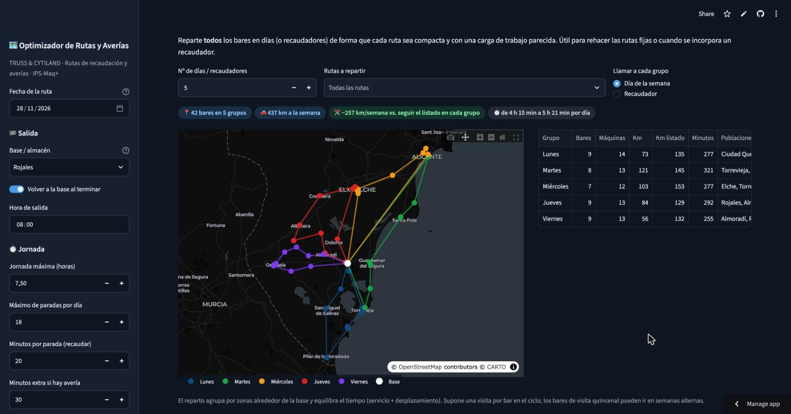
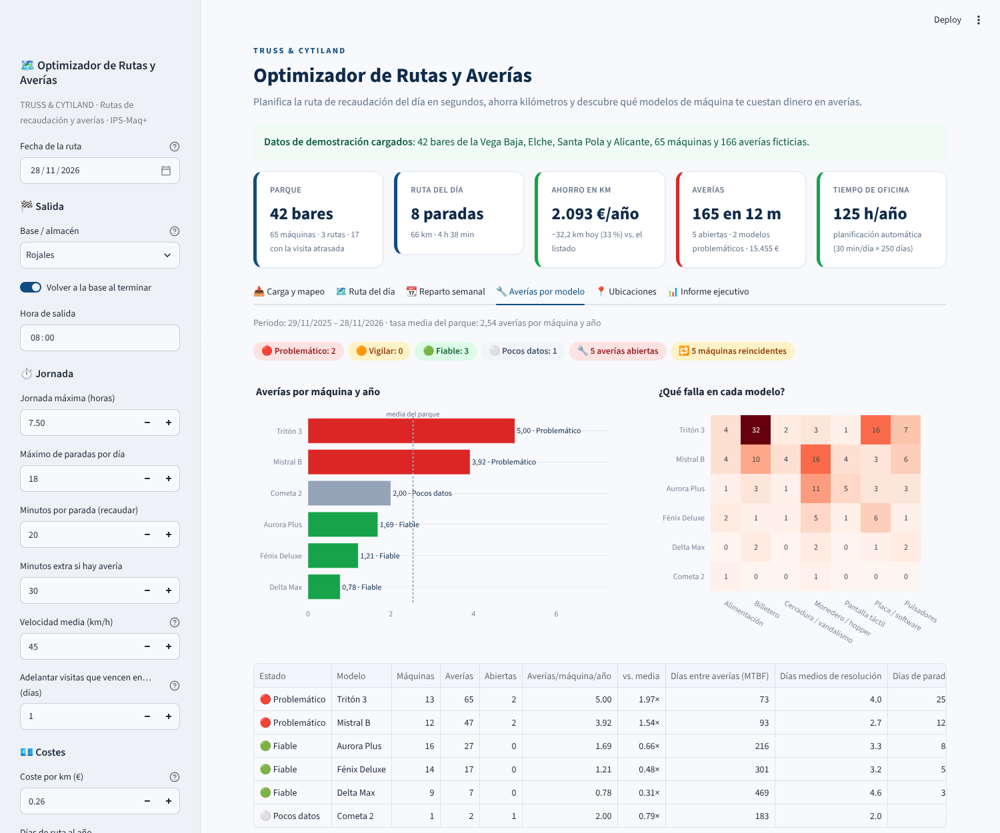
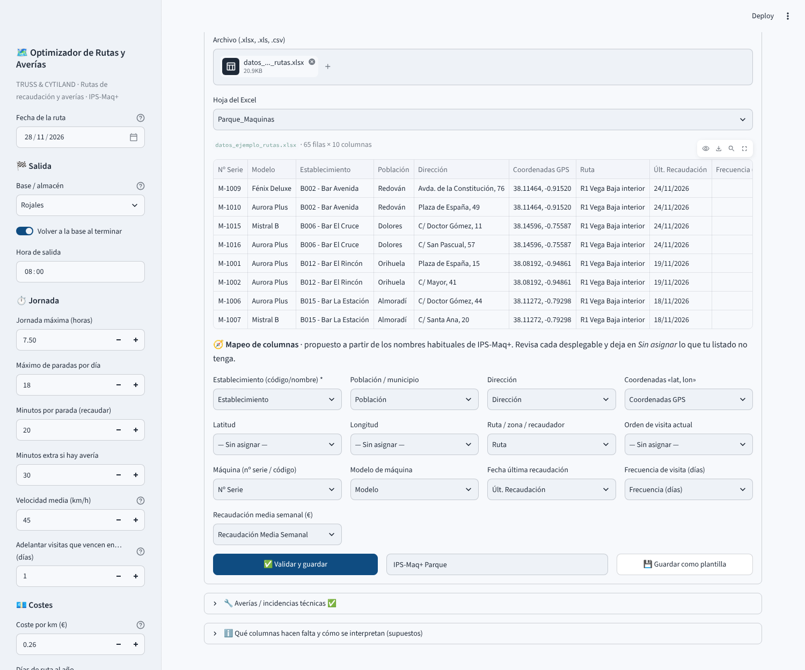
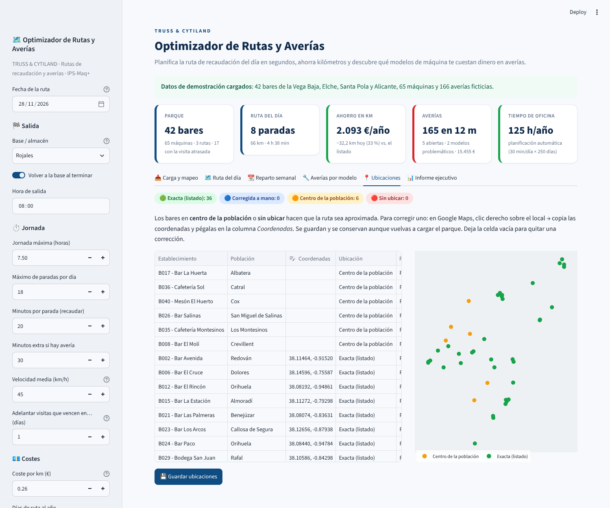

# 🗺️ Optimizador de Rutas y Averías

**Planificación de rutas de recaudación y seguimiento de averías por modelo de máquina para operadoras de máquinas recreativas, a partir de exportaciones del ERP IPS-Maq+.**
Decide cada mañana a qué bares toca ir, en qué orden y a qué hora se llega a cada uno; reparte la semana entre días o recaudadores, y descubre qué modelos de máquina se averían más y cuánto dinero cuestan.


Módulo 3 de la suite [Automatizaciones TRUSS/CYTILAND](../README.md).

**🔗 Demo en vivo: [optimizador-rutas-averias.streamlit.app](https://optimizador-rutas-averias.streamlit.app/)** (pulsa *Cargar datos de demostración*)



---

## 💼 El problema de negocio

Una operadora de la Vega Baja tiene decenas de bares repartidos entre Orihuela, Torrevieja, Rojales, Guardamar, Elche, Santa Pola o Alicante. Cada recaudador sigue su ruta "de memoria" o en el orden en que salen los bares en el listado del ERP, y las averías se apuntan sueltas sin saber qué modelo da más guerra. Las consecuencias:

- **kilómetros de más** cada día por un orden de visita que nadie ha optimizado;
- bares a los que **se pasa tarde** (efectivo acumulado en la máquina) y otros que se visitan antes de tiempo;
- una máquina averiada **espera** hasta que su bar "toca" en la ruta, y mientras tanto no recauda;
- se siguen comprando o instalando **modelos que se averían el doble** que la media sin que nadie lo cuantifique.

**El Optimizador cruza el parque de máquinas y el histórico de averías** y entrega la hoja de ruta del día, el ahorro frente a seguir el listado y un ranking de fiabilidad por modelo.

## ✨ Funcionalidades clave

| Módulo | Qué hace |
|---|---|
| **Carga inteligente** | Dos listados (parque de máquinas/establecimientos y averías) en `.xlsx`, `.xls` o `.csv`, con **selección de hoja**, sugerencia automática de columnas, **plantillas reutilizables** (`config_columnas.json`) y botón de **datos de demostración**. Solo son imprescindibles el bar y su población. |
| **Geolocalización sin servicios externos** | Usa las coordenadas del listado (lat/lon o «38.08, -0.72» copiado de Google Maps). Si no las hay, sitúa el bar en el **centro de su municipio** (tabla interna de la provincia de Alicante). Detecta lat/lon intercambiadas y coordenadas imposibles. |
| **Ruta del día** | Selecciona los bares **a los que toca recaudar** (días desde la última recaudación vs. frecuencia) y los que tienen **averías abiertas**, los ordena con **vecino más cercano + 2-opt + or-opt**, los ajusta a la jornada (si no caben, deja fuera los de menor prioridad, nunca una avería) y calcula **hora estimada de llegada** a cada parada. |
| **Ahorro medible** | Compara la ruta optimizada con **seguir el orden del listado** (o la columna «Orden de visita»): km, € al día y € al año. |
| **Navegación** | Enlaces de **Google Maps** con todas las paradas (en tramos de 10) y **hoja de ruta en Excel** para imprimir o mandar al móvil del recaudador. |
| **Reparto semanal** | Reparte todos los bares en N días o recaudadores con rutas **compactas** (barrido angular desde la base) y **carga de trabajo equilibrada**, y optimiza cada una. Útil para rehacer las rutas fijas. |
| **Averías por modelo** | Tasa de **averías por máquina y año**, **MTBF** (días entre averías), días de resolución, **días de parada**, coste, **recaudación perdida estimada** y fallo más común. Semáforo: 🔴 Problemático (≥ 1,5× la media) · 🟠 Vigilar (≥ 1,15×) · 🟢 Fiable · ⚪ Pocos datos. |
| **Máquinas reincidentes y abiertas** | Máquinas con ≥ 3 averías en 90 días (configurable) y averías pendientes, que entran solas como **parada prioritaria** en la ruta. |
| **Ubicaciones** | Tabla editable para pegar las coordenadas exactas de cada bar. Se guardan en SQLite y **se conservan entre cargas**. |
| **Informe ejecutivo** | Resumen para dirección y **Excel multi-pestaña**: resumen, hoja de ruta, reparto semanal, averías por modelo, reincidentes, abiertas y establecimientos. |
| **Modo claro y oscuro** | Tema corporativo TRUSS & CYTILAND; mapas y gráficos se adaptan (menú ⋮ → *Settings*). |

| Reparto semanal | Averías por modelo |
|---|---|
|  |  |

| Carga y mapeo | Ubicaciones |
|---|---|
|  |  |

## 🏗️ Arquitectura técnica

```
03-optimizador-rutas/          # módulo 3 de la suite Automatizaciones TRUSS/CYTILAND
├── app.py                     # Interfaz Streamlit (UI, mapas, estado de sesión)
├── analyzer.py                # Lógica pura: lectura, mapeo, geolocalización, rutas (2-opt), averías, KPIs, Excel
├── database.py                # Persistencia SQLite: parque (foto), averías (UPSERT), ubicaciones corregidas
├── sample_data.py             # Generador de datos ficticios de la Vega Baja con incidencias provocadas
├── lanzador.py                # Arranque local: puerto libre + apertura del navegador
├── iniciar_optimizador_rutas.bat  # Doble clic en Windows: venv + dependencias + app
├── requirements.txt
├── .streamlit/config.toml     # Tema corporativo claro y oscuro
└── docs/                      # Capturas para este README
```

```
 Parque IPS-Maq+ ──► Mapeo ──► Agrupar por bar ──► Ubicar (listado › corrección manual › centro del municipio)
                                                          │
 Averías IPS-Maq+ ─► Mapeo ──► SQLite (histórico) ──┐     │
                                     │              ▼     ▼
                          Averías por modelo   Paradas del día (toca recaudar + averías abiertas)
                          (tasa, MTBF, coste)            │
                                     │          Vecino más cercano → 2-opt → or-opt → ajuste a jornada
                                     │                   │
                                     └────► KPIs + Mapa + Hoja de ruta + Informe Excel
```

Decisiones de diseño:

- **Sin servicios externos ni claves de API**: las distancias se calculan con la fórmula del haversine × un **factor carretera** (1,30 por defecto, configurable) y un salto urbano mínimo de 0,8 km entre paradas. Ningún dato de la empresa sale del equipo (solo si el usuario pulsa *Abrir en Google Maps*).
- **Heurísticas en vez de un solver**: para rutas de 5-40 paradas, vecino más cercano + 2-opt + or-opt queda a pocos puntos del óptimo en milisegundos y no añade dependencias pesadas.
- **Separación UI / lógica**: `analyzer.py` y `database.py` no dependen de Streamlit.
- **Idempotencia**: subir dos veces el mismo listado de averías no duplica avisos; si un aviso abierto llega cerrado, se actualiza.
- **Privacidad por defecto**: el `.gitignore` bloquea bases de datos, Excel, CSV y `.env`; solo se permite el Excel ficticio generado por código.

### Supuestos del cálculo

- **A quién toca recaudar**: días desde la última recaudación ≥ frecuencia del bar (7 días por defecto) menos el margen de adelanto. Sin fecha de última recaudación, todos los bares se consideran pendientes.
- **Prioridad** (si no caben todos en la jornada): averías abiertas primero, después los más atrasados y los que más efectivo acumulan (recaudación media semanal / 7 × días sin visitar).
- **Tiempo de la ruta**: km / velocidad media (45 km/h por defecto, puerta a puerta) + minutos por parada (20) + minutos extra si hay avería (30).
- **Coste por km**: 0,26 €/km por defecto (importe exento de IRPF por uso de vehículo propio); ajústalo al coste real de la flota.
- **Averías**: una avería está abierta si su estado dice «pendiente/abierta/en curso» o, sin estado, si no tiene fecha de resolución. Recaudación perdida = días de parada × recaudación media diaria del modelo.
- **Reparto semanal**: una visita por bar en el ciclo; los bares de visita quincenal pueden ir en semanas alternas.

## 🚀 Instalación local con un clic (Windows)

1. Instala **Python 3.10 o superior** desde [python.org](https://www.python.org/downloads/) marcando **"Add python.exe to PATH"**.
2. Descarga o clona el repositorio y entra en la carpeta `03-optimizador-rutas`.
3. Haz **doble clic en `iniciar_optimizador_rutas.bat`**.

La primera vez crea el entorno virtual `.venv` e instala las dependencias (1-3 minutos). Las siguientes veces arranca en segundos y abre el navegador automáticamente.

### macOS / Linux (o manual)

```bash
cd 03-optimizador-rutas
python -m venv .venv
source .venv/bin/activate          # Windows: .venv\Scripts\activate
pip install -r requirements.txt
python sample_data.py              # opcional: genera datos_ejemplo_rutas.xlsx
streamlit run app.py
```

## 🧭 Guía rápida de uso

1. En **📥 Carga y mapeo**, sube el listado de máquinas/establecimientos de IPS-Maq+ (y, si quieres, el de averías) o pulsa **🎲 Cargar datos de demostración**.
2. **Revisa el mapeo** de columnas (viene propuesto), pulsa **Validar y guardar** y guárdalo como **plantilla**: las siguientes subidas se cargarán solas.
3. En la barra lateral elige la **base**, la hora de salida, la jornada y la velocidad media.
4. En **🗺️ Ruta del día** elige la ruta o zona: verás el mapa, el orden y la hora de llegada a cada bar. Descarga la hoja de ruta o ábrela en Google Maps.
5. Revisa **🔧 Averías por modelo** y, de vez en cuando, **📍 Ubicaciones** para afinar las coordenadas de los bares que estén en el centro del municipio.

## ☁️ Despliegue gratuito en Streamlit Community Cloud

1. Entra en [share.streamlit.io](https://share.streamlit.io) con tu cuenta de GitHub.
2. **Create app → Deploy a public app from GitHub** y selecciona: repositorio, rama `main` y archivo principal `03-optimizador-rutas/app.py`. Streamlit usa el `requirements.txt` de esa carpeta.
3. Pulsa **Deploy**. En 2-3 minutos tendrás la URL pública.

> En la nube el sistema de archivos es efímero: el histórico SQLite, las ubicaciones corregidas y las plantillas se reinician cuando la app se reinicia. Para la demo pública es lo deseable; para uso real, ejecútala en local.

## 🧪 Datos de demostración

`sample_data.py` genera 42 bares **ficticios** en 3 rutas (Vega Baja interior, Litoral sur y Elche-Santa Pola-Alicante), 65 máquinas de 6 modelos inventados y 12 meses de averías, con:

- el listado ordenado por código de bar (como suele salir del ERP), no por geografía, para medir el ahorro de la ruta optimizada;
- 6 bares sin coordenadas (solo población);
- dos modelos problemáticos (uno sobre todo por el billetero) y uno con una sola máquina;
- máquinas reincidentes y 5 averías abiertas.

Nombres de bares, direcciones, modelos y números de serie son inventados. Ningún dato real de clientes ni de la empresa forma parte del repositorio.

## 🗺️ Próximos pasos

- Ajustar el mapeo y los supuestos con las exportaciones reales de IPS-Maq+.
- Distancias por carretera reales con un servidor OSRM propio (sin enviar datos a terceros).
- Ventanas horarias por bar (hora de apertura/cierre) y días de cierre.

---

Desarrollado con Python, Streamlit, Pandas, Plotly y SQLite.
